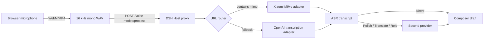

# dsh-voice-modes

Voice input for the [DeepSeek Harness](https://github.com/deepseek-ai/deepseek-harness) composer: a circular microphone button, a mode menu beside the model selector, and URL-routed ASR provider adapters.

> Community plugin. Not an official DeepSeek Harness project.
>
> Maintained by [bin-r00t](https://github.com/bin-r00t). `@nibuil` is the npm publishing scope only; it does not refer to the GitHub user `nibuil`.

[中文说明](./README.zh.md)

## Features

- **Circular microphone button** next to the composer's model selector.
- **Four modes**:
  - **Direct** — insert the transcript as-is.
  - **Polish** — remove filler words, repetitions and pauses while preserving meaning.
  - **Translate** — polish, then translate into English.
  - **Custom role** — organize the transcript with a user-defined role prompt.
- **URL-routed ASR adapters**:
  - Xiaomi MiMo ASR (`chat/completions` + `input_audio`)
  - OpenAI-compatible transcription (`/audio/transcriptions` multipart)
  - More adapters can be added through one documented interface.
- **Automatic WAV conversion** in the browser (16 kHz mono PCM) so providers that only accept WAV/MP3 work.
- **Second provider** for text processing (Polish / Translate / Custom role) and as an ASR fallback.
- **Editable roles** with built-in examples.
- **Host-side credentials** — API keys are stored by the DSH Host and are never returned to the browser.

## Install

```bash
dsh plugin --profile web add @nibuil/dsh-voice-modes
```

Or install the bundle through **DSH Plugin Manager**. Restart the Web Host (`dsh web`) if DSH reports that a restart is required, then refresh the page.

After installation, click the mode dropdown in the composer and choose **Voice settings**.

## Configure

### ASR provider

| Field    | Required | Notes                                         |
| -------- | -------- | --------------------------------------------- |
| Endpoint | Yes      | A `/v1` base URL or a full provider endpoint. |
| API key  | Yes      | Stored on the Host only.                      |
| Model    | Yes      | Adapter-specific default is used when empty.  |

The adapter is selected from the endpoint URL:

| URL contains  | Adapter                         | Request                                    |
| ------------- | ------------------------------- | ------------------------------------------ |
| `mimo`        | Xiaomi MiMo ASR                 | JSON `chat/completions` with `input_audio` |
| anything else | OpenAI-compatible transcription | multipart `/audio/transcriptions`          |

To force the MiMo adapter through a proxy URL, append a marker: `https://proxy.example/asr#mimo`.

Examples:

```text
https://api.xiaomimimo.com/v1
https://api.xiaomimimo.com/v1/chat/completions
https://api.openai.com/v1
https://api.groq.com/openai/v1
```

### Second provider

Optional, but required for **Polish**, **Translate** and **Custom role**. It must expose an OpenAI-compatible `chat/completions` endpoint. The same provider is also tried as an ASR fallback when the primary ASR fails.

### Roles

The settings dialog includes four examples: meeting notes, technical notes, business email and product request. Add, edit or remove roles freely.

### Translation

English is the only target language in this release.

## How it works



The browser never calls an ASR provider directly and never receives a stored API key. The Host stores settings in `~/.dsh/voice-modes/settings.json` with mode `0600` and exposes same-origin routes protected by DSH's connection authentication.

See [docs/architecture.md](./docs/architecture.md) for details.

## Development

Requirements: Node.js 20+ and a DSH installation.

```bash
git clone https://github.com/bin-r00t/dsh-voice-modes.git
cd dsh-voice-modes
npm test
npm run check
```

Install the working copy through DSH Plugin Manager or:

```bash
dsh plugin --profile web add "file:$PWD"
```

Restart `dsh web` after Host-side changes. Client-only changes reload through the Web HMR channel; refresh the page if they do not.

### Mock provider

Test the whole flow without a real ASR account:

```bash
node debug/mock-provider.mjs
```

Use `http://127.0.0.1:8787/v1` for the generic adapter, or `http://127.0.0.1:8787/v1#mimo` for the MiMo adapter.

### Adding an ASR provider

Read [docs/adding-asr-provider.md](./docs/adding-asr-provider.md), add the adapter to [`providers.js`](./providers.js), and extend the tests.

## Compatibility

- Tested with DSH `0.2.1-rc.2`.
- The package declares `engines.dsh`; incompatible DSH versions are rejected before the plugin is imported.
- The Client half uses `conversation.input.activity`, `ctx.slots`, and `ctx.locale`. These are current DSH extension points, not a frozen public API.

## Security

- API keys are stored on the Host and are not returned by the settings API.
- Audio and keys are never intentionally logged.
- The configured ASR URL is fetched by the Host. Only configure endpoints you trust.
- Report vulnerabilities privately; see [SECURITY.md](./SECURITY.md).

## Contributing

Contributions are welcome, especially new ASR adapters, browser compatibility fixes, translations and tests.

- [CONTRIBUTING.md](./CONTRIBUTING.md)
- [Code of Conduct](./CODE_OF_CONDUCT.md)
- [Open an issue](https://github.com/bin-r00t/dsh-voice-modes/issues)
- [Start a discussion](https://github.com/bin-r00t/dsh-voice-modes/discussions)

## License

[MIT](./LICENSE)
