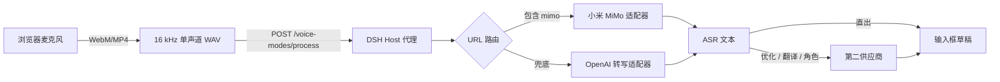

# dsh-voice-modes

为 [DeepSeek Harness](https://github.com/deepseek-ai/deepseek-harness) 输入框提供语音输入：圆形麦克风按钮、模型选择器旁的语音模式菜单，以及按 URL 自动路由的 ASR 供应商适配器。

> 社区插件，非 DeepSeek Harness 官方项目。
>
> 由 [bin-r00t](https://github.com/bin-r00t) 维护。`@nibuil` 仅是 npm 发布 scope，与 GitHub 用户 `nibuil` 无关。

[English](./README.md)

## 功能

- **圆形语音按钮**：位于输入框底部、模型选择器旁。
- **四种模式**：
  - **直出**：识别结果原样插入。
  - **优化**：删除语气词、重复和停顿，保留原意。
  - **翻译**：先整理，再翻译成英语。
  - **自定义角色**：按用户配置的角色提示词整理内容。
- **按 URL 路由的 ASR 适配器**：
  - 小米 MiMo ASR（`chat/completions` + `input_audio`）
  - OpenAI 兼容转写（`/audio/transcriptions` multipart）
  - 通过统一接口继续增加供应商。
- **浏览器内自动转 WAV**：16 kHz 单声道 PCM，兼容只接受 WAV/MP3 的供应商。
- **第二供应商**：用于优化、翻译和自定义角色，同时作为 ASR 备用线路。
- **可编辑角色**：内置示例，支持新增、修改、删除。
- **密钥保存在 Host**：API Key 不返回浏览器。

## 安装

```bash
dsh plugin --profile web add @nibuil/dsh-voice-modes
```

也可以在 **DSH Plugin Manager** 中安装 bundle。如果 DSH 提示需要重启，请重启 `dsh web` 后刷新页面。

安装完成后，点击输入框旁的语音模式下拉菜单，进入 **语音设置**。

## 配置

### ASR 供应商

| 字段     | 必填 | 说明                         |
| -------- | ---- | ---------------------------- |
| 接口地址 | 是   | `/v1` 基础地址或完整接口地址 |
| API Key  | 是   | 只保存在 Host                |
| 模型     | 是   | 为空时使用适配器默认值       |

适配器根据接口地址自动选择：

| URL 包含 | 适配器          | 请求方式                                |
| -------- | --------------- | --------------------------------------- |
| `mimo`   | 小米 MiMo ASR   | JSON `chat/completions` + `input_audio` |
| 其他     | OpenAI 兼容转写 | multipart `/audio/transcriptions`       |

通过代理访问 MiMo 时，可以在 URL 后加标记强制匹配：`https://proxy.example/asr#mimo`。

示例：

```text
https://api.xiaomimimo.com/v1
https://api.xiaomimimo.com/v1/chat/completions
https://api.openai.com/v1
https://api.groq.com/openai/v1
```

### 第二供应商

可选，但 **优化 / 翻译 / 自定义角色** 必须配置。它需要提供 OpenAI 兼容的 `chat/completions` 接口；主 ASR 失败时也会作为备用线路尝试。

### 角色

设置中内置会议纪要、技术说明、商务邮件、产品需求四个示例，可自由新增、编辑和删除。

### 翻译

当前仅支持翻译成英语。

## 工作原理



浏览器不会直接请求 ASR 供应商，也不会收到已保存的 API Key。Host 将配置保存在 `~/.dsh/voice-modes/settings.json`（权限 `0600`），并通过 DSH 连接认证保护同源路由。

详细设计见 [docs/architecture.md](./docs/architecture.md)。

## 开发

要求：Node.js 20+，已安装 DSH。

```bash
git clone https://github.com/bin-r00t/dsh-voice-modes.git
cd dsh-voice-modes
npm test
npm run check
```

通过 DSH Plugin Manager 安装工作副本，或：

```bash
dsh plugin --profile web add "file:$PWD"
```

Host 侧改动后需要重启 `dsh web`；Client 侧改动会通过 Web HMR 重载，必要时刷新页面。

### Mock 供应商

无需真实 ASR 账号即可测试完整链路：

```bash
node debug/mock-provider.mjs
```

通用适配器使用 `http://127.0.0.1:8787/v1`，MiMo 适配器使用 `http://127.0.0.1:8787/v1#mimo`。

### 增加 ASR 供应商

阅读 [docs/adding-asr-provider.md](./docs/adding-asr-provider.md)，在 [`providers.js`](./providers.js) 中增加适配器，并补充测试。

## 兼容性

- 已在 DSH `0.2.1-rc.2` 上测试。
- 包声明了 `engines.dsh`，不兼容的 DSH 版本会在导入插件前被拒绝。
- Client 侧使用 `conversation.input.activity`、`ctx.slots` 和 `ctx.locale`。这些是当前 DSH 扩展点，不是冻结的公共 API。

## 安全

- API Key 只保存在 Host，设置接口不会返回密钥。
- 不会主动记录音频或密钥。
- Host 会请求你配置的 ASR 地址，请只配置可信服务。
- 漏洞请私下报告，见 [SECURITY.md](./SECURITY.md)。

## 参与贡献

欢迎贡献，尤其是新的 ASR 适配器、浏览器兼容性修复、翻译和测试。

- [CONTRIBUTING.md](./CONTRIBUTING.md)
- [Code of Conduct](./CODE_OF_CONDUCT.md)
- [提交 Issue](https://github.com/bin-r00t/dsh-voice-modes/issues)
- [参与讨论](https://github.com/bin-r00t/dsh-voice-modes/discussions)

## 许可证

[MIT](./LICENSE)
