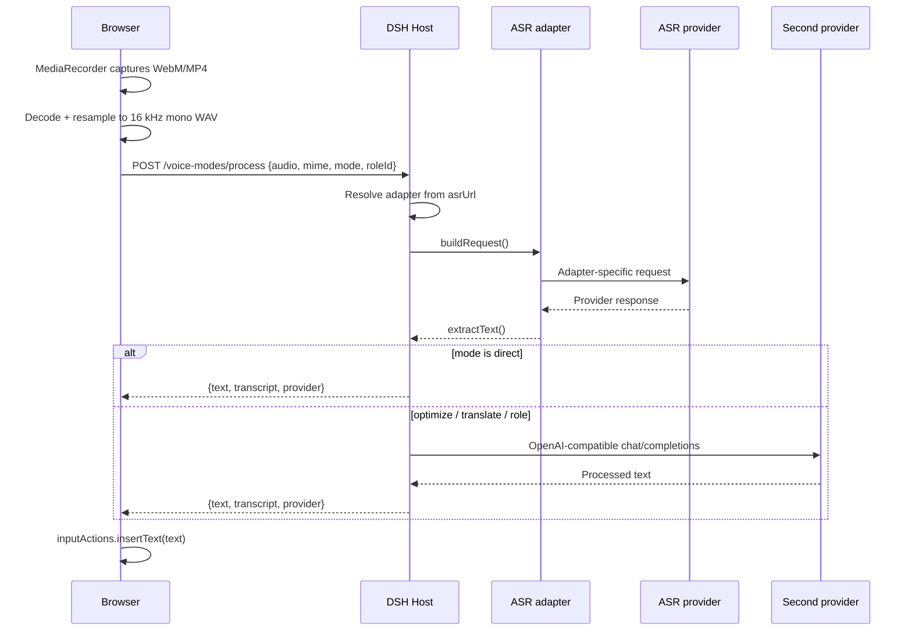

# Architecture

`dsh-voice-modes` is a DSH bundle with a Host half and a Web Client half. The Host owns credentials, provider routing, persistence and upstream network calls. The Client owns recording, WAV conversion, mode UI and draft insertion.

## Components

| File | Role |
| --- | --- |
| `index.js` | Host plugin: routes, settings persistence, ASR/LLM orchestration, prompts |
| `providers.js` | Built-in ASR catalogue and URL detection |
| `client.js` | Web UI: microphone, mode menu, settings dialog, WAV conversion |
| `cordis.patch.yml` | Inserts the Host plugin row |
| `locale/*.json` | Plugin Manager display metadata |
| `debug/mock-provider.mjs` | Local provider for development |

## Request flow



## Settings and credentials

Settings live at:

```text
$DSH_HOME/voice-modes/settings.json
```

The Host writes the file with mode `0600`. The settings API returns:

- URLs and model names;
- `hasAsrApiKey` / `hasSecondaryApiKey` booleans;
- the detected adapter descriptor;
- the built-in adapter catalogue;
- roles and target language.

It never returns stored API keys. An empty secret field on save means “keep the existing secret”; `null` clears it.

## Routes

The Host registers a prefix route under `/voice-modes`:

| Method | Path | Purpose |
| --- | --- | --- |
| `GET` | `/voice-modes/settings` | Redacted settings and provider catalogue |
| `POST` | `/voice-modes/settings` | Validate and persist settings |
| `POST` | `/voice-modes/process` | Transcribe and optionally process audio |

All routes call `ctx.connection.requestRejection(req)` first. Requests without DSH browser authentication receive `401`; this is why `curl` from a terminal is not a valid test.

## Adapter routing

`resolveAsrProvider(url)` walks the catalogue in order:

1. `xiaomi-mimo` — matches `mimo` in the configured URL, including a `#mimo` fragment on a proxy URL.
2. `openai-transcription` — unconditional fallback, kept last.

Each adapter decides:

- endpoint derivation (`/v1` base vs full endpoint);
- headers (`api-key` vs Bearer);
- request body (JSON or multipart);
- model fallback;
- accepted MIME types and size limit;
- response text extraction.

The Host enforces `acceptsMime` and `maxAudioBytes` before calling `buildRequest`.

## Audio pipeline

The browser records with `MediaRecorder`, which commonly produces WebM/Opus (Chromium/Firefox) or MP4/AAC (Safari). The Client then:

1. Decodes with Web Audio `decodeAudioData`.
2. Downmixes and resamples with `OfflineAudioContext` to 16 kHz mono.
3. Encodes 16-bit PCM WAV.
4. Uploads Base64 audio to the Host.

This keeps payloads small enough for providers with strict formats and 10 MB limits. If conversion fails, the original blob is sent; an adapter that does not accept it returns `unsupported-audio-format`.

## UI integration

The Client registers one component into `conversation.input.activity`, immediately after the model selector and before the submit action. It uses only:

- `ctx.slots.inject` / `ctx.slots.register`
- `ctx.locale.register` / `ctx.locale.bind` / `ctx.locale.subscribe`
- standard slot props `inputActions` and `sessionId`

Draft insertion uses `inputActions.insertText(text, inputActions.captureInsertion())`, so an async result is only inserted if the editor revision is still valid. If insertion fails, the Client attempts to copy the result to the clipboard.

## Text modes

- **Direct** returns the ASR transcript unchanged.
- **Polish** uses a system prompt that removes fillers and repetitions but forbids summarizing or adding content.
- **Translate** combines cleanup and English translation in one call.
- **Custom role** inserts the role prompt into the system instruction and asks for only the final text.

The second provider must expose an OpenAI-compatible `chat/completions` endpoint.

## Failure handling

- Upstream errors are returned to the Client as `{ error, message }`; the message includes provider context and a bounded response excerpt.
- The primary ASR failure triggers the second provider as an ASR fallback when configured.
- Text-mode errors do not alter the draft.
- Settings writes are validated before persistence.

## Security boundaries

- Credentials stay on the Host.
- The configured provider URL is trusted by the Host and can point at private addresses; this is a deliberate capability with a documented SSRF risk.
- Audio and keys must not be logged by adapters.
- The plugin uses DSH's connection authentication rather than a separate token.

## Extension roadmap

- Host service for third-party ASR adapter packages.
- Streaming partial transcripts.
- ASR language selection and per-provider options.
- Microphone device selection and configurable duration.
- Additional locales and role templates.
